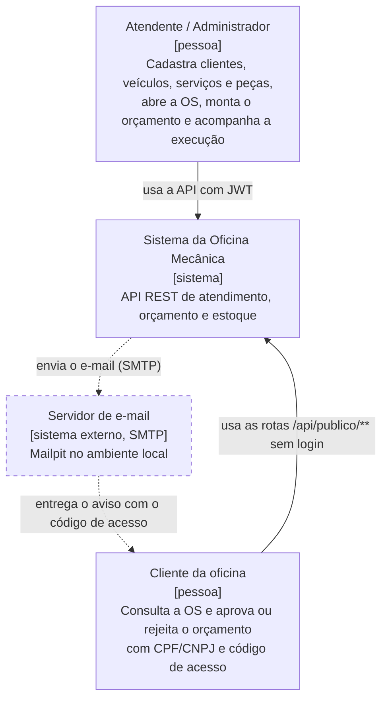
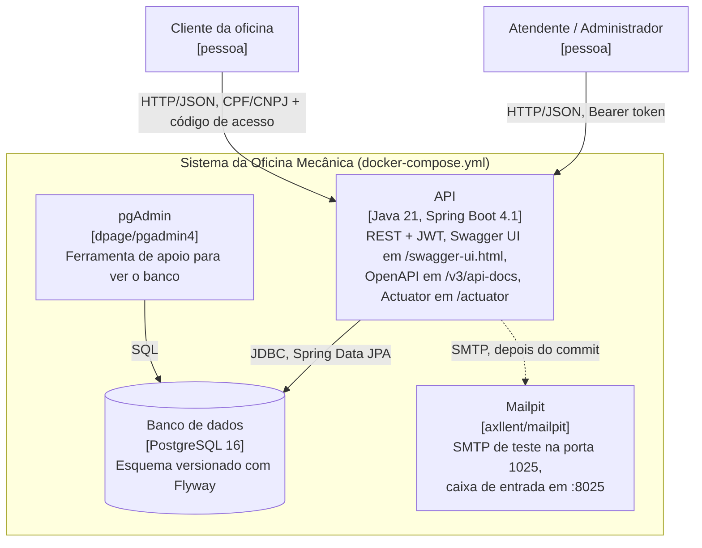
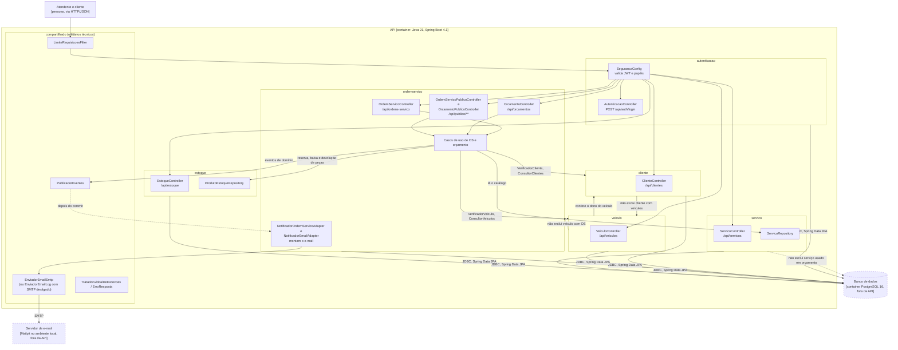

# Diagramas C4

Os três primeiros níveis do C4, em Mermaid para renderizar no GitHub. Não há fila: os avisos ao cliente saem por e-mail (SMTP) depois do commit. No ambiente local quem recebe é o Mailpit.

## Legenda

| Elemento | Como aparece |
|---|---|
| Pessoa | caixa com `[pessoa]` |
| Sistema (nível 1) | caixa com `[sistema]` |
| Container (nível 2) | caixa com a tecnologia entre colchetes; o banco aparece como cilindro |
| Limite do sistema ou do container | retângulo de agrupamento (`subgraph`) com o nome |
| Componente (nível 3) | classe ou grupo de classes dentro do módulo, com a rota HTTP quando for controller |
| Fora do container | elemento com borda tracejada |
| Seta contínua | chamada síncrona ou dependência direta, com o protocolo ou a interface no rótulo |
| Seta tracejada | aviso depois do commit (e-mail) ou verificação que só bloqueia exclusão |

## Nível 1: contexto

## Nível 2: containers

O container `app` só sobe com `docker compose --profile app up`. Sem o perfil, sobem o banco, o pgAdmin e o Mailpit. Em produção o Mailpit seria trocado por um servidor SMTP de verdade, configurado por `MAIL_HOST`, `MAIL_PORT` e credenciais.

## Nível 3: componentes da API

Componentes da API agrupados por módulo. Cada módulo tem as camadas `domain`, `application` e `infrastructure` (ver [ADR 0001](adr/0001-monolito-modular-em-camadas.md)).

Os erros de todos os controllers passam pelo `TratadorGlobalDeExcecoes`, que devolve `ErroResposta`.
