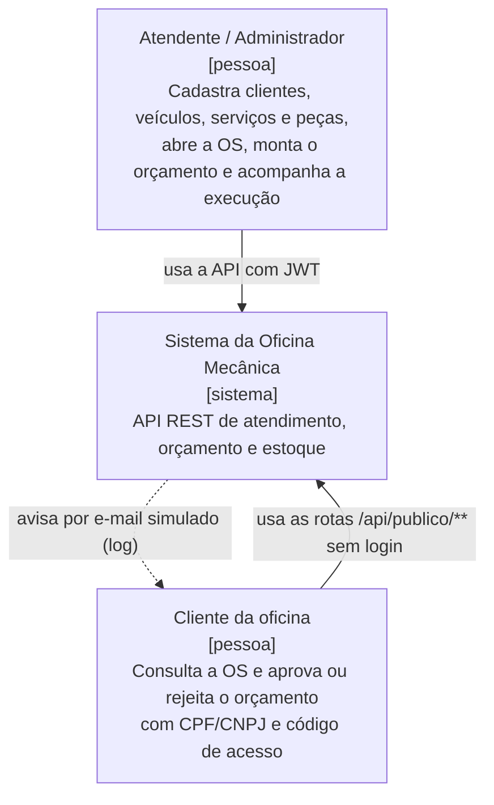
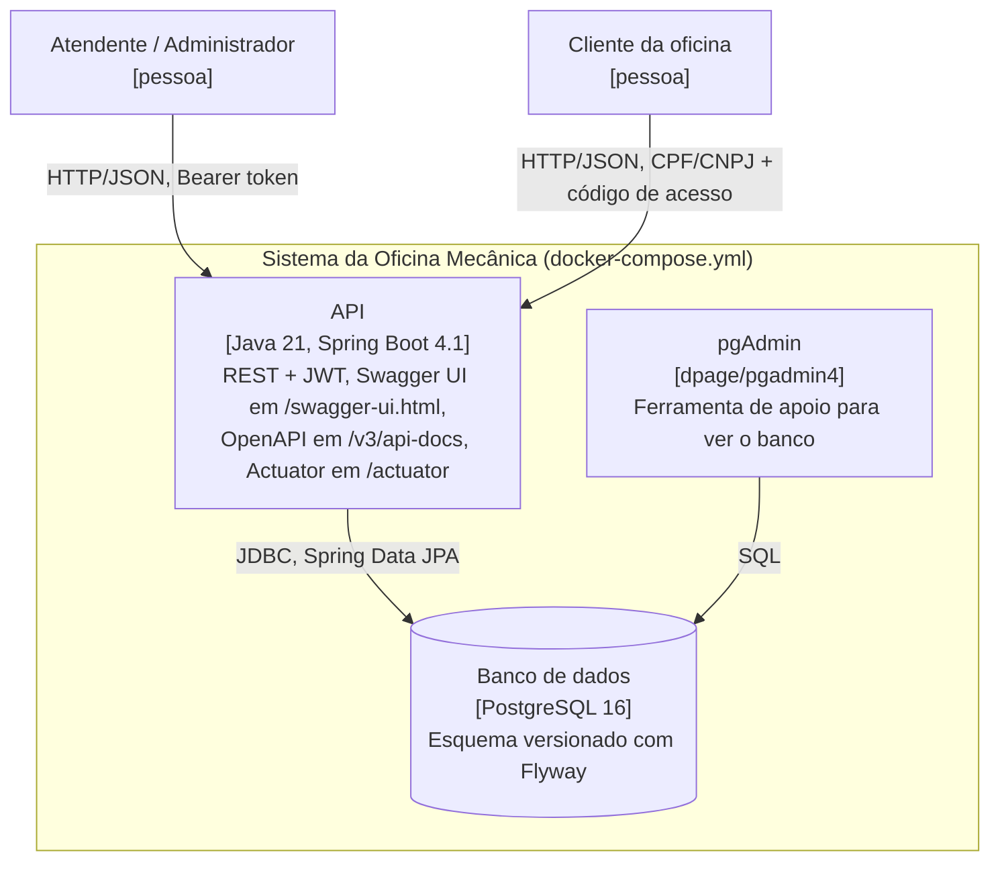
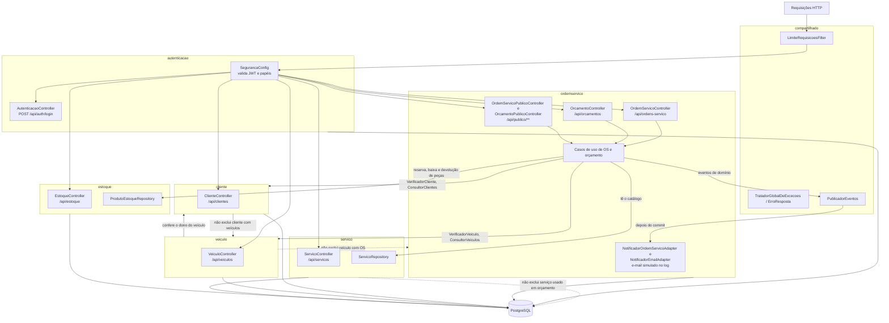

# Diagramas C4

Os três primeiros níveis do C4, desenhados com `flowchart` do Mermaid para renderizar direto no GitHub. Só aparece o que existe no código. Não há servidor de e-mail, fila nem integração externa: os avisos ao cliente são um e-mail simulado escrito no log da aplicação.

## Nível 1: contexto

## Nível 2: containers

O container `app` só sobe com `docker compose --profile app up`. Sem o perfil, sobem o banco e o pgAdmin.

## Nível 3: componentes da API

Cada módulo tem as camadas `domain`, `application` e `infrastructure` (ver [ADR 0001](adr/0001-monolito-modular-em-camadas.md)). As setas mostram quem usa quem entre os módulos.

Os erros de todos os controllers passam pelo `TratadorGlobalDeExcecoes`, que devolve sempre `ErroResposta`.
